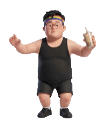

# 夏爾桌面版（ciel-desktop）

一隻住在 macOS Dock 上方的桌面小人。戴彩虹頭帶、拿珍奶，會自己走來走去。

<p>


</p>

## 它會做什麼

| 情境 | 動作 |
|---|---|
| 閒著 | 沿著 Dock 上方走來走去；偶爾停下來吸一口珍奶、左右看看、朝你揮手 |
| 點它一下 | 揮手，跳出輸入框，可以問它問題（要接後端，見下面） |
| 等回答時 | 小口小口喝珍奶 |
| 你 5 分鐘沒碰電腦 | 打哈欠、坐到地上打瞌睡；你一動就醒 |
| 拎起來 | 在空中亂踢亂揮，珍奶死抓不放 |
| 放手 | 掉下去、跌坐、愣住、抓頭、尷尬地笑 |
| 右鍵 | 問問題／去睡覺／叫醒／結束 |

透明的地方點擊會穿過去，不會擋到後面的視窗。

## 安裝

需要 macOS 14 以上，和 Xcode Command Line Tools（有 `swiftc` 就行）。

```bash
git clone https://github.com/KurseLu/ciel-desktop.git
cd ciel-desktop
./build.sh                       # 產生 夏爾.app（ad-hoc 簽名）
cp -R 夏爾.app ~/Applications/
open ~/Applications/夏爾.app
```

整個 App 就是一個檔案：`CielPet.swift`（AppKit），沒有其他相依套件。

## 接上問答後端（選用）

不接也能玩，只是點它問問題時會說「還沒設定」。

後端規格很簡單：收 `POST`，JSON 內容 `{"q": "問題"}`，標頭帶 `X-Token`，回傳純文字。
我們自己的版本是在另一台電腦上，收到問題後叫 headless Claude Code 回答。

```bash
mkdir -p ~/.config/ciel-desktop && chmod 700 ~/.config/ciel-desktop
echo "https://你的後端/路徑" > ~/.config/ciel-desktop/endpoint
echo "你的 token"           > ~/.config/ciel-desktop/token
chmod 600 ~/.config/ciel-desktop/*
```

逾時設 120 秒，回答會顯示在它頭上的泡泡裡。

## 換成你自己的角色

動作都是「AI 生影片 → 切格 → 去背」做出來的，換角色照這個流程走：

1. **角色圖**：一張全身、站姿、純淺灰背景的 3D 角色圖（我們是用 Gemini 生的）。
2. **動作影片**：拿這張圖當參考圖，請 AI 生 10 秒影片，每段一個動作。提示詞的重點是**鏡頭固定、背景純淺灰、角色全身置中**；走路要寫「側面朝右、原地踏步」，程式會自己移動視窗。
3. **切格去背**：

   ```bash
   swiftc -O cutframes.swift -o cutframes
   mkdir raw_walk && ffmpeg -i walk.mp4 -vf fps=12 raw_walk/frame_%03d.png
   ./cutframes raw_walk frames/walk 280     # 用 macOS Vision 去背，整段對齊同一個外框
   ```

4. **對動作範圍**：`CielPet.swift` 裡 `Pet.init` 指定每個動作用哪幾格（例如 `walk[8...37]` 是無縫循環的那段），換了影片要重新挑。

`frames/` 底下目前有五組：`walk`、`idle`（喝珍奶＋揮手）、`sleep`、`held`（被拎著）、`land`（跌坐爬起）。

小提醒：卡通圓臉角色做「跌倒」這類動作，影片 AI 有時會當成兒童而拒絕生成；在提示詞寫明角色是成年人通常就會過。

## 授權

MIT。角色「夏爾」是 KurseLu 的 AI 助理的形象，影格可以拿去玩、拿去改。
